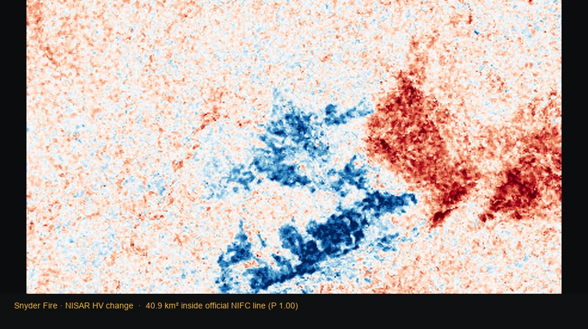
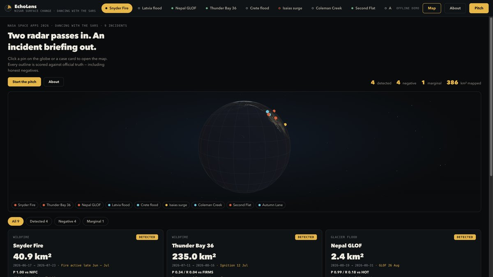
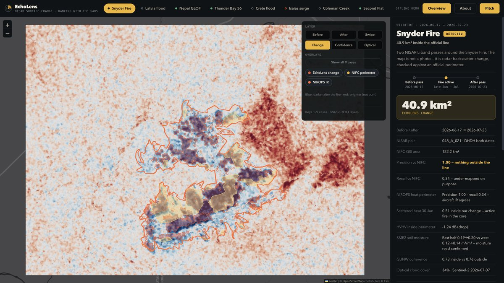
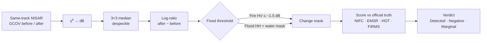
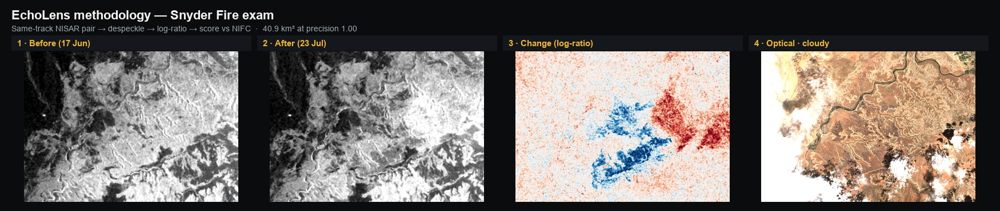
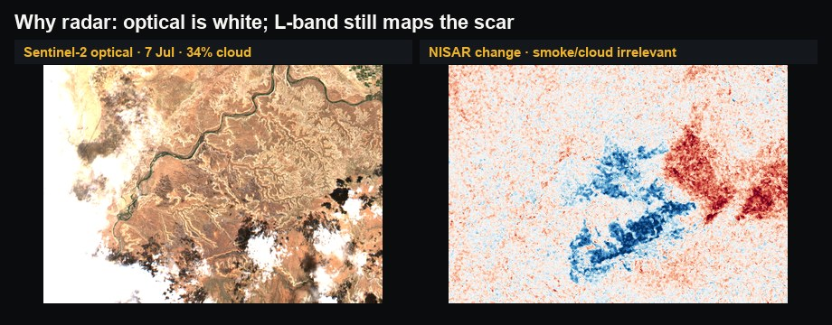
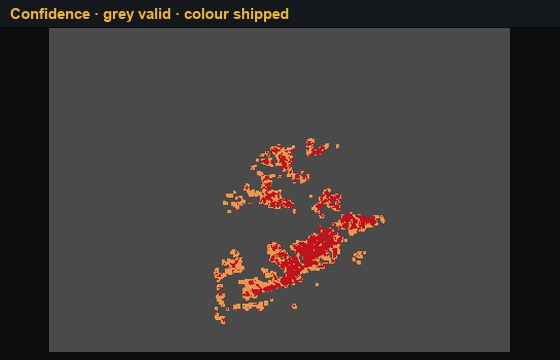
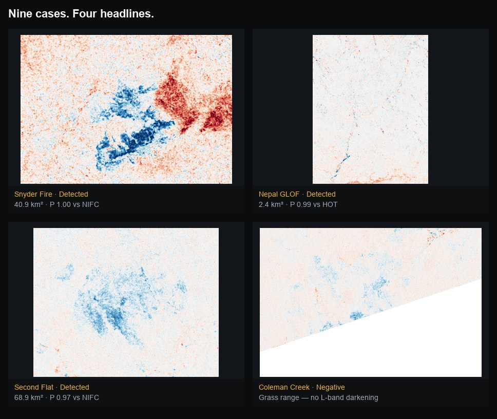

# EchoLens

**Two NISAR radar passes in. An incident briefing out.**

[](https://echolens-theta.vercel.app)
[](https://www.spaceappschallenge.org/)
[](https://www.spaceappschallenge.org/)
[](LICENSE)

Solo project by **[Muhammad Umer Aamir](https://github.com/umeraamir69)** · NASA Space Apps Toronto 2026 · *Dancing with the SARs*

| | |
|---|---|
| **Live demo** | https://echolens-theta.vercel.app |
| **Repository** | https://github.com/umeraamir69/Nasa-SpaceApp |

<p align="center">
  
</p>

<p align="center"><em>Snyder Fire exam case — HV log-ratio change inside the official NIFC line.</em></p>

---

## Product

EchoLens turns a before/after **NISAR L-band** pair into a briefing a human can read in under a minute: what changed, how many km², and why the outline is trustworthy — including when the honest answer is **no**.

<p align="center">
  
</p>

<p align="center"><em>Overview globe — nine incidents, detected / negative / marginal at a glance.</em></p>

<p align="center">
  
</p>

<p align="center"><em>Case map — layers, truth overlays, fragment inspector, printable briefing.</em></p>

**What ships**

- **9 real incidents** — wildfire, glacier flood, flash flood, hurricane surge  
- **Same-mode pairs only** — track + radar mode verified before any pixel is scored  
- **Truth-checked** against NIFC, Copernicus EMSR, HOT, NASA FIRMS, NIROPS  
- **Honest negatives** — grass fires and drained floods that L-band should not invent  
- **Live UI** — globe, swipe, confidence, pitch tour, one-page print  

No neural net. Classical SAR math you can explain in one sentence.

---

## Methodology

Radar does not look with light. NISAR L-band measures **backscatter**. When vegetation burns (or flood water arrives), that echo changes. EchoLens turns that physics into a scored outline.



### Step by step

| Step | What happens | Why it matters |
|---|---|---|
| **1. Pair** | Two L2 **GCOV** granules, same relative orbit, same radar mode | Geometry cancels — change is ground change, not look-angle |
| **2. Calibrate** | Convert γ⁰ power to decibels | Log space makes drops additive and human-readable |
| **3. Despeckle** | 3×3 median filter | Speckle grain is not a fire |
| **4. Subtract** | Log-ratio = after − before | Blue = darker after (burn / new water); red = brighter |
| **5. Threshold** | Fires: **HV** ≥ 1.5 dB darker · Floods: **HH** with permanent lakes masked | One fixed cut — no per-scene tuning, no black box |
| **6. Score** | Precision / recall vs official polygons | Publish under-mapping and honest negatives |
| **7. Second vote** | GUNW coherence when it splits | Shown when useful — **never faked** when it does not |

<p align="center">
  
</p>

### Why SAR (not just optical)

<p align="center">
  
</p>

Same week over Snyder, Sentinel-2 is **34% cloud**. The radar scar is still there. That is the product thesis.

### Confidence layer

<p align="center">
  
</p>

Grey = valid radar swath. Colour = change we are willing to ship. Outside the swath stays empty — no invented pixels.

Full narrative: **[docs/a-to-z.md](docs/a-to-z.md)** · Pitch: **[docs/pitch.md](docs/pitch.md)** · Submit kit: **[docs/submission.md](docs/submission.md)**

---

## Cases

<p align="center">
  
</p>

| Case | Type | Verdict | Headline |
|---|---|---|---|
| Snyder Fire | Wildfire | Detected | 40.9 km² · precision **1.00** vs NIFC |
| Thunder Bay 36 | Wildfire | Detected | 235 km² severe core · FIRMS-scored |
| Second Flat | Wildfire | Detected | 68.9 km² · precision **0.97** vs NIFC |
| Nepal Rasuwa GLOF | Glacier flood | Detected | 2.4 km² · precision **0.99** vs HOT |
| Latvia flood | Flood | Negative | Post-peak dry-down — flood wave gone |
| Crete flood | Flash flood | Negative | Drained before the Oct 9 pass |
| Coleman Creek | Wildfire | Negative | Grass/range — no L-band darkening |
| Autumn Lane (Spokane) | WUI fire | Negative | Structures + grass — invisible to HV |
| Isaias surge | Hurricane | Marginal | 0.5 km² bay fringe, unvalidated |

---

## Live demo

**https://echolens-theta.vercel.app** — no install. Globe → case map → Pitch.

### Demo video

| | |
|---|---|
| Full (~86 s) | [docs/assets/echolens-demo.mp4](docs/assets/echolens-demo.mp4) |
| Space Apps cut (30 s) | [docs/assets/echolens-demo-30s.mp4](docs/assets/echolens-demo-30s.mp4) |

Rebuild locally: `cd scripts/demo-video && npm run make` (see [docs/demo-video.md](docs/demo-video.md)).

---

## Quick start (local)

Map products in `outputs/` are already in the repo. **No Earthdata login** needed to view.

```bash
git clone https://github.com/umeraamir69/Nasa-SpaceApp.git
cd Nasa-SpaceApp
python3 -m venv venv
source venv/bin/activate          # Windows: venv\Scripts\activate
pip install -r requirements.txt   # API + demo; reprocessing: requirements-process.txt
cd web && npm install --cache ../.npm-cache && cd ..
./demo.sh
```

Opens **http://127.0.0.1:5173** (API on `:8000`).

---

## NASA & partner data

| Source | Role |
|---|---|
| [NISAR L2 GCOV](https://www.earthdata.nasa.gov/) Provisional | Primary change detection |
| NISAR L2 GUNW Provisional | Coherence second vote |
| [NASA FIRMS](https://firms.modaps.eosdis.nasa.gov/) VIIRS | Thunder Bay hotspot truth |
| NIFC WFIGS | Fire perimeter truth |
| Copernicus EMSR / HOT | Flood & GLOF truth |
| Sentinel-2 L2A | Cloudy optical “why SAR” chip |

Credentials only if you re-download granules: `EARTHDATA_USERNAME` / `EARTHDATA_PASSWORD` via env — **never** commit secrets.

---

## Stack

| Layer | Tech |
|---|---|
| Processing | Python · h5py · numpy · scipy · shapely · rasterio · earthaccess |
| API | FastAPI · uvicorn (also hosts the live Vercel deploy) |
| UI | React · Vite · Leaflet · three.js |

---

## Repo layout

| Path | What |
|---|---|
| `app/` | FastAPI — cases, GeoJSON, confidence, media |
| `web/` | Briefing console (Overview globe is the landing page) |
| `scripts/` | Search, download, change, validate |
| `outputs/<case>/` | `summary.json`, GeoJSON, `layers/*.png` |
| `docs/assets/` | README figures |
| `demo.sh` | One-command local demo |

---

## Author

**Muhammad Umer Aamir** — solo builder (SAR pipeline, validation, UI, demo).

- GitHub: [umeraamir69](https://github.com/umeraamir69)
- LinkedIn: [umeraamir69](https://www.linkedin.com/in/umeraamir69/)
- Live: [echolens-theta.vercel.app](https://echolens-theta.vercel.app)

---

## License

[MIT](LICENSE) © 2026 Muhammad Umer Aamir

NISAR / FIRMS / Sentinel-2 / NIFC / Copernicus data remain under their respective terms; this repo ships derived briefing products and code only.
