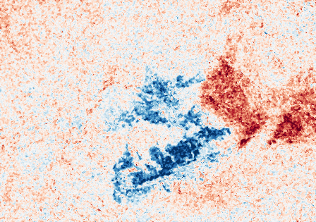

# EchoLens

**Two NISAR radar passes in. An incident briefing out.**

[](https://echolens-theta.vercel.app)
[](https://www.spaceappschallenge.org/)
[](https://www.spaceappschallenge.org/)
[](LICENSE)
[](https://github.com/umeraamir69/Nasa-SpaceApp)

Solo project by **[Muhammad Umer Aamir](https://github.com/umeraamir69)** for **NASA Space Apps Toronto 2026** — challenge *Dancing with the SARs*.

EchoLens turns a before/after **NISAR L-band** pair into a map a human can brief in under a minute: what changed, how many km², and why the outline is trustworthy — including when the honest answer is **no**.

| | URL |
|---|---|
| **Live demo** | https://echolens-theta.vercel.app |
| **Repository** | https://github.com/umeraamir69/Nasa-SpaceApp |

---

## What you get

- **9 real incidents** — wildfire, glacier flood, flash flood, hurricane surge
- **Same-mode NISAR pairs only** — track + radar mode verified before any pixel is scored
- **Truth-checked** against NIFC, Copernicus EMSR, HOT, NASA FIRMS, NIROPS
- **Honest negatives published** — grass fires and drained floods that L-band should not invent
- **Live briefing UI** — globe overview, case map, swipe, confidence, pitch tour, printable one-pager

No neural net. Classical SAR: despeckle → log-ratio → fixed threshold → precision/recall vs official truth.

| Case | Type | Verdict | Headline |
|---|---|---|---|
| Snyder Fire | Wildfire | Detected | 40.9 km² · precision **1.00** vs NIFC |
| Thunder Bay 36 | Wildfire | Detected | 235 km² severe core · FIRMS-scored |
| Second Flat | Wildfire | Detected | 68.9 km² · precision **0.97** vs NIFC |
| Nepal Rasuwa GLOF | Glacier flood | Detected | 2.4 km² · precision **0.99** vs HOT |
| Latvia flood | Flood | Negative | Post-peak dry-down — flood wave gone |
| Crete flood | Flash flood | Negative | Drained before the Oct 9 pass |
| Coleman Creek | Wildfire | Negative | Grass/range — no L-band darkening |
| Autumn Lane (Spokane) | WUI fire | Negative | Structures + grass — invisible to HV |
| Isaias surge | Hurricane | Marginal | 0.5 km² bay fringe, unvalidated |



---

## Live demo

**https://echolens-theta.vercel.app** — globe overview, nine cases, pitch tour. No install.

## Quick start (local, ~2 min)

Map products in `outputs/` are already in the repo (~30 MB). **No Earthdata login** needed to view the demo.

```bash
git clone https://github.com/umeraamir69/Nasa-SpaceApp.git
cd Nasa-SpaceApp
python3 -m venv venv
source venv/bin/activate          # Windows: venv\Scripts\activate
pip install -r requirements.txt   # API + demo; for reprocessing: requirements-process.txt
cd web && npm install --cache ../.npm-cache && cd ..
./demo.sh
```

Opens **http://127.0.0.1:5173** (API on `:8000`).

Manual start:

```bash
# terminal 1
source venv/bin/activate
uvicorn app.main:app --host 127.0.0.1 --port 8000

# terminal 2
cd web && npm run dev -- --host 127.0.0.1 --port 5173
```

No servers? Open any `outputs/*/layers/change.png`.

---

## Method (one paragraph)

Same-track, same-mode NISAR L2 **GCOV** pair → γ⁰ to dB → 3×3 median despeckle → log-ratio. Fires use **HV** (≥ 1.5 dB darker). Floods use **HH** with permanent water masked. Score against official truth; ship detected / negative / marginal with numbers. GUNW coherence is a second vote when it helps — never faked when it does not.

Full walkthrough: **[docs/a-to-z.md](docs/a-to-z.md)** · Pitch: **[docs/pitch.md](docs/pitch.md)** · Space Apps paste kit: **[docs/submission.md](docs/submission.md)**

---

## NASA & partner data

| Source | Role |
|---|---|
| [NISAR L2 GCOV](https://www.earthdata.nasa.gov/) Provisional | Primary change detection |
| NISAR L2 GUNW Provisional | Coherence second vote |
| [NASA FIRMS](https://firms.modaps.eosdis.nasa.gov/) VIIRS | Thunder Bay hotspot truth |
| NIFC WFIGS | Fire perimeter truth |
| Copernicus EMSR / HOT | Flood & GLOF truth |
| Sentinel-2 L2A | Cloudy optical “why SAR” chip |

Credentials (only if you re-download granules): `EARTHDATA_USERNAME` / `EARTHDATA_PASSWORD` via env — **never** commit secrets.

---

## Stack

| Layer | Tech |
|---|---|
| Processing | Python · h5py · numpy · scipy · shapely · rasterio · earthaccess |
| API | FastAPI · uvicorn |
| UI | React · Vite · Leaflet · three.js (overview globe) |

---

## Repo layout

| Path | What |
|---|---|
| `app/` | FastAPI — `/api/cases`, `/api/case`, `/api/geojson/*`, `/api/confidence` |
| `web/` | Briefing console (Overview globe is the landing page) |
| `scripts/` | Search, download, change, validate |
| `outputs/<case>/` | `summary.json`, GeoJSON, `layers/*.png` (in git) |
| `data/` | Local granules (gitignored, ~35 GB) |
| `docs/` | Guides + submission package |
| `tests/` | Asset / API contract tests |
| `demo.sh` | One-command API + web |

Private working notes stay on the author’s machine (not in this public repo).

---

## Reproduce a case from NASA (optional)

Earthdata account + disk. Authorize **ASF DAAC**. Example Snyder:

```bash
python scripts/search_nisar.py --event snyder
python scripts/download_nisar.py
python scripts/change_snyder.py
```

Other cases: `download_*.py` → `change_*.py` (see script table in older docs / `scripts/`). Processing with h5py/rasterio prefers `.conda/env/bin/python` (3.12) if the default venv cannot build wheels.

---

## Author

**Muhammad Umer Aamir** — solo builder (SAR pipeline, validation, UI, demo).

- GitHub: [umeraamir69](https://github.com/umeraamir69)
- LinkedIn: [umeraamir69](https://www.linkedin.com/in/umeraamir69/)
- Location: Waterloo, Ontario, Canada

---

## License

[MIT](LICENSE) © 2026 Muhammad Umer Aamir

NISAR / FIRMS / Sentinel-2 / NIFC / Copernicus data remain under their respective terms; this repo ships derived briefing products and code only.
